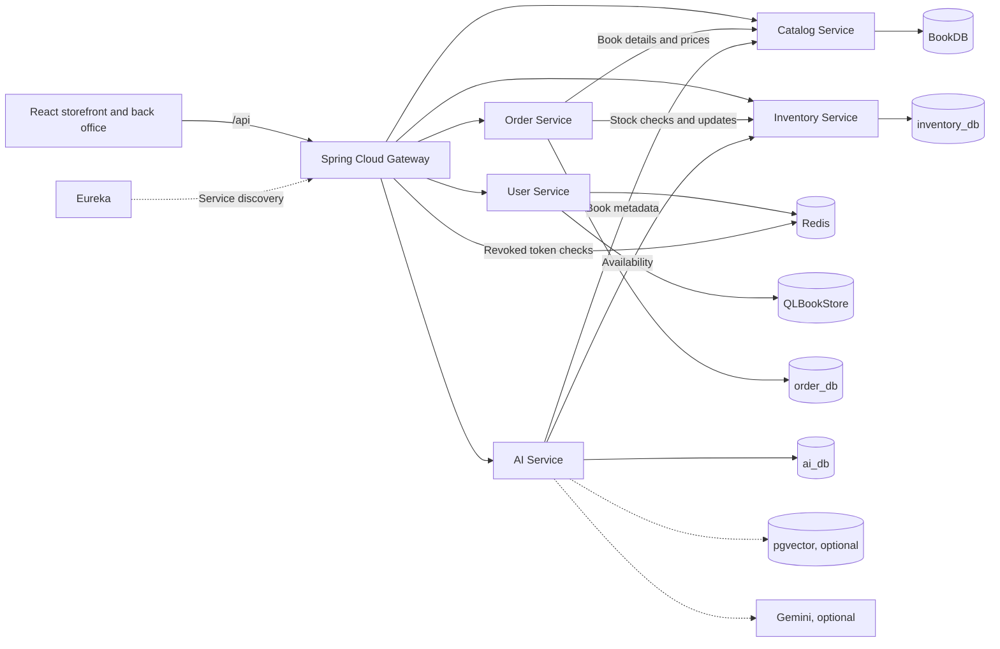

# BookStore Microservices

A Vietnamese online bookstore with a React storefront, a back office, and an AI book advisor. Spring Boot services handle accounts, catalog, inventory, and orders behind a single API gateway.

[Features](#key-features) · [Architecture](#overall-architecture) · [Installation](#installation) · [Run locally](#running-the-project) · [Configuration](#environment-configuration) · [Contributing](#contribution-guidelines)

## Introduction

BookStore covers the workflow from finding a book to fulfilling a cash-on-delivery (COD) order. Customers can browse the catalog, check availability, and track their orders. Staff and administrators can maintain the catalog, manage stock, and process orders from the back office.

The project is organized as a monorepo. Each business service owns a separate PostgreSQL database and accesses other domains through HTTP. A local PostgreSQL instance can host all five business databases.

## Key features

| Area | What you can do |
| --- | --- |
| Storefront | Search and filter books, view details and availability, and save favorites. |
| Accounts | Register, sign in, manage a profile, and access back-office screens according to your role. |
| Checkout | Manage a cart, place a COD order, and view order history. Customers can cancel pending or confirmed orders. |
| Catalog and inventory | Manage books, authors, categories, publishers, and stock. |
| Order operations | Confirm, prepare, ship, and close orders. Bestseller rankings use delivered and paid orders. |
| AI book advisor | Ask for book suggestions with links to the catalog. Gemini and pgvector are optional. The advisor can fall back to catalog-based suggestions. |

Checkout currently supports COD. The password reset email adapter writes OTP messages to local logs for development.

## Overall architecture



**Stack.** React, Vite, and Tailwind CSS on the frontend. Java 21, Spring Boot, Spring Cloud Gateway, and Eureka on the backend. PostgreSQL stores application data, Redis supports authentication-related features and caching, and Maven builds the Java modules.

**Order and stock lifecycle.** Checkout checks stock and saves a `PENDING` order with the book title and unit price captured at purchase time. Inventory is deducted when staff move the order to `CONFIRMED`. Canceling a pending order leaves stock untouched. Canceling an order that already deducted stock, or marking a delivered order as returned, restores inventory. A delivered COD order is marked paid.

## Installation

### Prerequisites

| Tool | When you need it |
| --- | --- |
| Git | Clone the repository. |
| Java 21 and Maven | Build and run the backend locally. |
| Node.js 22.12+ and npm | Build and run the frontend locally. |
| PostgreSQL and Redis | Run the application locally. You can use existing instances or start both with Docker Compose. |
| Docker Desktop with Linux containers, or Docker Engine with Compose v2 | Run containerized PostgreSQL, Redis, or the optional vector store. |
| pgAdmin or PostgreSQL client tools | Restore a sample database when one has been provided. |

The local startup and shutdown commands below use Windows PowerShell.

### Clone and install dependencies

```powershell
git clone https://github.com/HuyBeros/Bookstore_Microservices.git
cd Bookstore_Microservices

Copy-Item .env.example .env
Copy-Item bookstore-frontend/.env.example bookstore-frontend/.env

Push-Location bookstore-frontend
npm ci
Pop-Location
```

Run the two copy commands on a fresh checkout. If your checkout already has environment files, update them in place. Fill in the three required values listed in [Environment configuration](#environment-configuration) before starting the project. Set `AI_RAG_ENABLED=false` for a first run without a vector database.

### Prepare the databases

Choose one setup.

- **PostgreSQL through Docker Compose.** The first startup of the default stack creates `QLBookStore` and the four additional databases listed in the architecture diagram. The [initialization script](docker/init-db/01-create-databases.sql) runs on a fresh PostgreSQL volume.
- **Existing PostgreSQL.** Create `QLBookStore`, `BookDB`, `inventory_db`, `order_db`, and `ai_db`. Preserve the casing of `QLBookStore` and `BookDB` and give the configured database user access to all five. Set `DB_HOST`, `DB_PORT`, `DB_USERNAME`, and `DB_PASSWORD` to match.

Catalog and AI use Flyway migrations. User, Order, and Inventory create or update their schemas through Hibernate in the local setup.

### Restore sample data with pgAdmin

The default local setup creates the schemas. For a populated storefront, restore the supplied sample data or add books and stock through the admin interface.

1. For a backup that includes schema and data, restore it into an empty target database before the first application startup. Use **Restore** for a PostgreSQL custom-format archive. For a plain SQL script, use the Query Tool for SQL-only files or `psql` for scripts containing commands such as `\connect` or `COPY ... FROM stdin`.
2. For a data-only backup, initialize the schema first. Stop the application before loading the backup into the matching database.
3. For checkout tests, restore catalog books and inventory with matching book IDs. Restore Order and User data only if the test needs existing orders or accounts. Use sanitized demo data and register fresh customer accounts for testing.

For example, run a plain SQL catalog script that targets an existing `BookDB`:

```powershell
psql -h localhost -U postgres -d BookDB -X -v ON_ERROR_STOP=1 -f .\BookDB.sql
```

## Running the project

### Local Windows setup

With a working `.env`, run one of these commands from the project root.

```powershell
# Start PostgreSQL and Redis via Docker, build the backend, and start the website.
.\start-all.ps1

# Use this instead when PostgreSQL and Redis are already running.
.\start-all.ps1 -SkipInfrastructure
```

The startup script waits for the Java services and checks routing through the gateway before starting Vite. Use `-SkipBuild` after building the backend or `-SkipFrontend` when working only with the API.

If PostgreSQL runs on your machine and you only need Redis from Docker, start Redis with `docker compose up -d --wait redis`, then run the startup script with `-SkipInfrastructure`.

| Endpoint | Local address |
| --- | --- |
| Storefront | [localhost:5173](http://localhost:5173) |
| Gateway | `http://localhost:8080` |
| Eureka | `http://localhost:8761` |
| Business services | User `8081`, Catalog `8082`, Order `8083`, Inventory `8084`, AI `8085` |
| Infrastructure | PostgreSQL `5432`, Redis `6379`, optional vector store `5433` |

Check that the catalog is reachable through the same `/api` path the browser uses.

```powershell
Invoke-RestMethod 'http://localhost:5173/api/catalog/books?page=0&size=5'
```

Register a customer and place a COD order for a book in stock. Sign in as the configured admin and confirm the order to verify that inventory decreases. Check logs under `logs/` if startup or routing fails. Stop the processes recorded by the startup script with `.\stop-all-services.ps1`. If you started the default infrastructure through Docker, use `docker compose stop postgres redis` to stop those containers and retain their data.

## Environment configuration

Use the [root template](.env.example) for local backend services and the [frontend template](bookstore-frontend/.env.example) for Vite.

| Variable | Local default | Purpose |
| --- | --- | --- |
| `DB_HOST`, `DB_PORT`, `DB_USERNAME` | `localhost`, `5432`, `postgres` | PostgreSQL connection settings. |
| `DB_PASSWORD` | Required | Password for the configured PostgreSQL user. |
| `JWT_SECRET` | Required | A shared Base64-encoded secret of at least 32 random bytes. |
| `JWT_ISSUER`, `JWT_AUDIENCE` | `http://localhost:8081`, `bookstore` | Keep the issuer and audience consistent across token producers and validators. |
| `ADMIN_USERNAME`, `ADMIN_PASSWORD` | `admin`, password required | Credentials used to seed the local admin account. Changing the environment file does not rotate an existing account password. |
| `REDIS_HOST`, `REDIS_PORT` | `localhost`, `6379` | Redis connection for User Service and Gateway. |
| `VITE_API_URL`, `VITE_USE_MOCK` | `/api`, `false` | Use the gateway proxy with the real backend for end-to-end testing. |

Generate a JWT secret in PowerShell and paste the result into `JWT_SECRET`.

```powershell
$jwtBytes = New-Object byte[] 32
$jwtRandom = [Security.Cryptography.RandomNumberGenerator]::Create()
try {
    $jwtRandom.GetBytes($jwtBytes)
    [Convert]::ToBase64String($jwtBytes)
} finally {
    $jwtRandom.Dispose()
}
```

### Optional AI configuration

- **Catalog-only testing.** Set `AI_RAG_ENABLED=false` and leave `GEMINI_API_KEY` and `GEMINI_MODEL` blank.
- **Gemini and vector retrieval.** Set `GEMINI_API_KEY`, `GEMINI_MODEL`, and `AI_RAG_ENABLED=true`. With the default vector database settings, run `docker compose --profile ai-rag up -d --wait ai-vectors` before starting or restarting AI Service. It indexes catalog books into `bookstore_vectors` after startup.

Keep credentials in local environment files. Vite exposes `VITE_*` values to the browser.

## Folder structure

```text
.
├── bookstore-frontend/   React storefront and back office
├── eureka-server/        Service registry
├── api-gateway/          Routing and token revocation checks
├── user-services/        Authentication, accounts, and roles
├── catalog-service/      Books, authors, categories, and publishers
├── inventory-service/    Stock and inventory transactions
├── order-service/        Cart, orders, COD, and sales statistics
├── ai-service/           Book advice, retrieval, and reading history
├── docker/init-db/        PostgreSQL database initialization
├── scripts/              Integration tests and catalog metadata audit
├── docker-compose.yml    Local infrastructure
├── start-all.ps1         Local startup
├── stop-all-services.ps1 Local shutdown
└── pom.xml               Maven reactor for the Java modules
```

## Contribution guidelines

1. Open an issue or describe the change in your pull request. For bugs, include reproduction steps and expected behavior.
2. Create a branch from `main` and keep the change focused. Preserve service ownership of data and the controller → service → repository layering. Document changes to request or response formats and database migrations.
3. Run the relevant checks below and include the results in the pull request. For UI changes, include a screenshot or short recording when it helps reviewers.
4. Keep secrets, database dumps, build output, and local logs out of the commit.

```powershell
mvn test

Push-Location bookstore-frontend
npm test
npm run build
Pop-Location
```

For changes that affect several services, run the [HTTP integration script](scripts/test-http-integration.ps1) in PowerShell 7 with Docker running. It starts an isolated stack with H2 and Redis.

```powershell
mvn -B -ntp '-Dmaven.repo.local=.cache/m2' test package
.\scripts\test-http-integration.ps1
```

For vector storage changes, run `.\scripts\test-ai.ps1` with Docker running. It uses a temporary pgvector database.

## License

The repository does not currently include a `LICENSE` file. Contact the repository owner before reusing or redistributing the code.

## Roadmap

The following items are proposed. They describe future work and have no committed release dates.

- **Reproducible testing.** Automate local setup checks in CI and cover the customer and admin paths from sign-in through delivery.
- **Stock and order consistency.** Define the stock reservation policy at checkout and add reconciliation for failures between Order and Inventory.
- **Database changes.** Adopt versioned migrations for services that currently rely on Hibernate schema updates.
- **Payment and account recovery.** Integrate a payment provider with verified callbacks and replace the development OTP logger with email delivery.
- **AI and catalog quality.** Improve book metadata, evaluate recommendation accuracy, and explore read-only reporting for admins.
